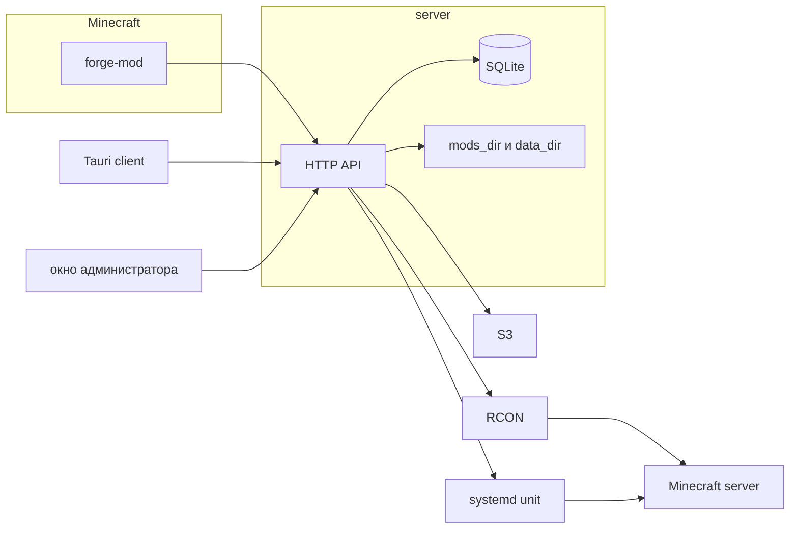
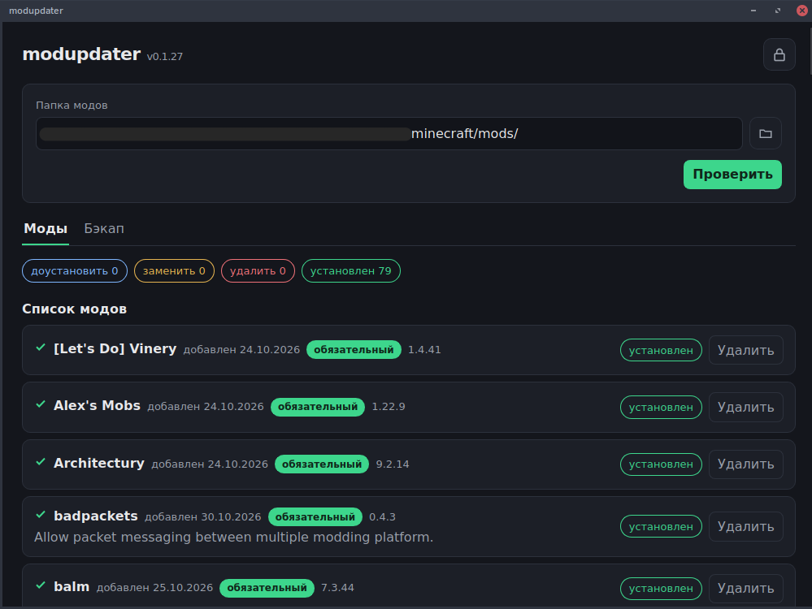
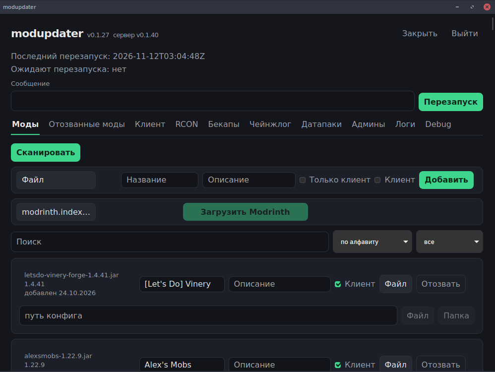
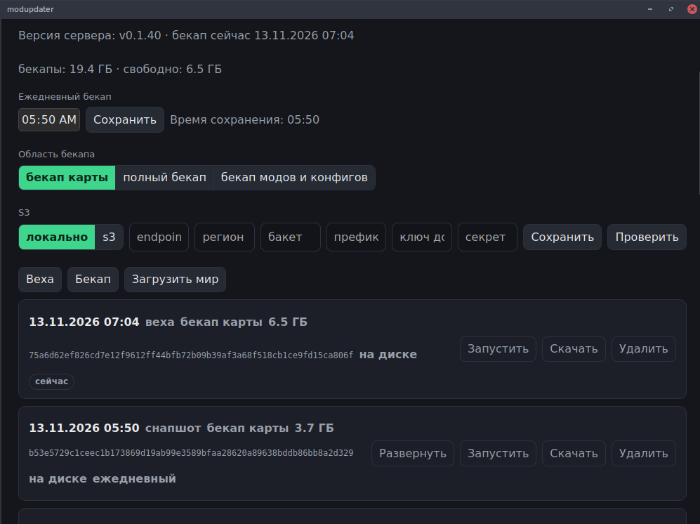
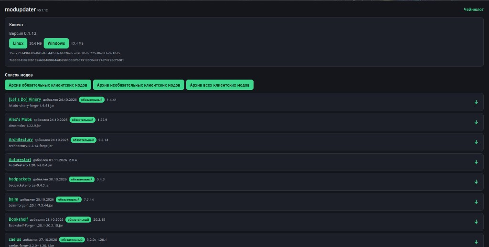
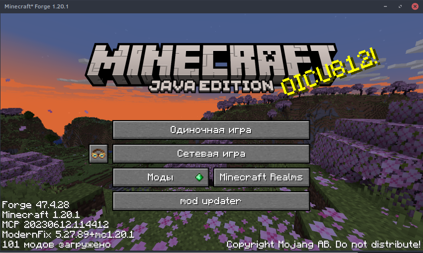
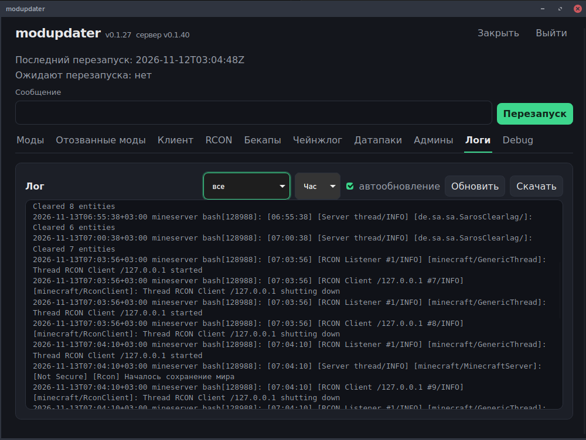
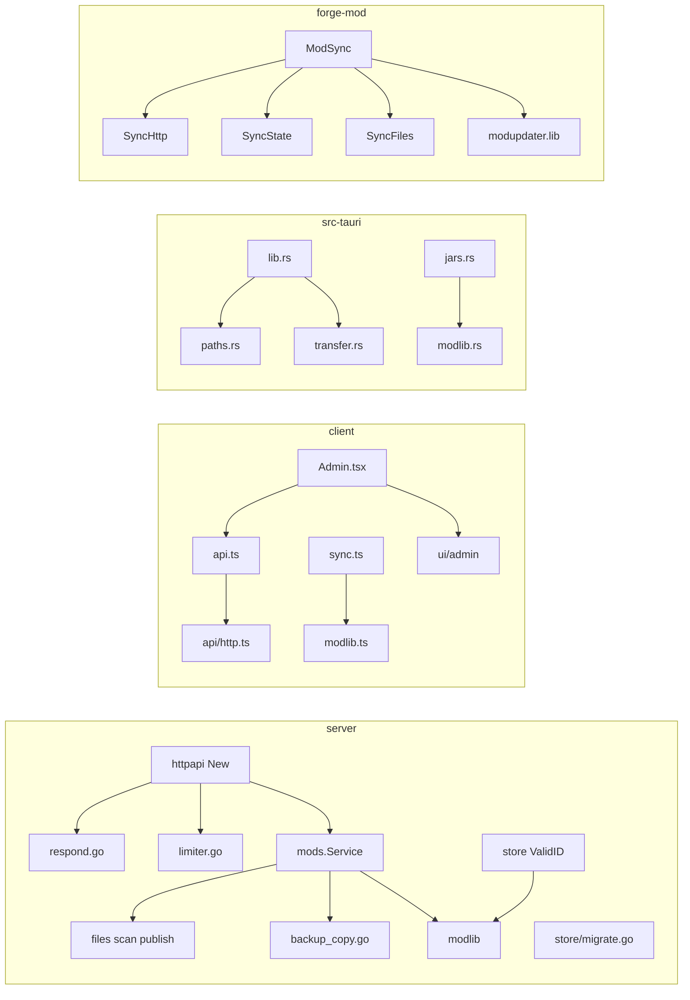

# modupdater

Сервер раздаёт клиентские моды Minecraft, клиент Tauri ставит их в локальную папку, мод Forge делает то же из игры.

English: a small stack that keeps a Minecraft client's mods in sync with a server-side catalog. Go HTTP API, Tauri desktop app, Forge 1.20.1 client mod.

## Проблема

Игроки должны вручную скачивать те же jar, что стоят на сервере, и следить за версиями. Администратору нужен отдельный канал, чтобы выложить мод, конфиг или датапак и при необходимости перезапустить сервер.

## Возможности

Сервер (`server/`):

- публичный список модов с `client=1`, скачивание jar и архива истории;
- страницы `/`, `/mods/{id}`, `/changelog`;
- вход администратора, сессии, refresh, приглашения `/invite/{token}`;
- каталог живых jar задаётся через `PUT /api/admin/settings` (`mods_dir`), скан каталога, загрузка и отзыв модов;
- импорт `.mrpack` Modrinth;
- конфиги модов для клиента и сервера;
- датапаки: загрузка zip и правка файлов;
- чейнжлог по истории модов;
- релизы десктоп-клиента (linux и windows), самообновление;
- бэкапы мира: расписание, снимок, веха, откат, запуск копии, выгрузка zip, загрузка мира;
- хранение бэкапов на диске или в S3, дедупликация чанками;
- перезапуск unit systemd после предупреждения в чат по RCON, чтение `journalctl`;
- CLI `cmd/upload` заливает собранный клиент, `cmd/backup-merge` собирает каталог из вехи и снимка.

Клиент (`client/`):

- окно Tauri: папка модов, сверка sha256 и slug, установка и замена jar, локальные `.bak`;
- конфиги модов и бэкап инстанса;
- вход администратора и панель: моды, отозванные, клиент, RCON, бэкапы, чейнжлог, датапаки, админы, логи;
- адрес сервиса вшит при сборке, в окне настроек его нет.

Мод (`forge-mod/`):

- клиентский мод Forge 1.20.1;
- кнопка на главном экране, проверка обязательных модов, скачивание jar и конфигов с того же HTTP API.

## Архитектура



Браузер без приложения открывает HTML-страницы скачивания. Секреты RCON и пароль корневого администратора остаются в конфиге процесса. Ключи S3 пишутся в SQLite из админки.

## Стек

- Сервер: Go 1.27.1, `modernc.org/sqlite` без CGO, AWS SDK v2 для S3, bcrypt.
- Клиент: React 18, TypeScript, Vite 6, Vitest, Tauri 2, Rust, reqwest с rustls.
- Мод: Java 17, Minecraft 1.20.1, Forge 47.4.28.
- Сборка релизов: Makefile, `scripts/`.

## Установка и запуск

Нужны Go 1.27.1+, Node.js 20, npm. Окно Tauri дополнительно требует Rust и системный WebKitGTK 4.1 / GTK 3 на Linux. Мод собирается JDK 17.

```bash
cp .env.example .env
cp server/config.example.json server/config.json
set -a && source .env && set +a
```

Пароли и RCON лучше задать переменными `MODUPDATER_*`. Непустое значение перекрывает поле `config.json`. Если `MODUPDATER_ROOT_PASSWORD` и пароль в json пустые, сервер один раз печатает `root_password=`. Повторный запуск пароль не сбрасывает и в файл не пишет.

Сервер:

```bash
cd server
CGO_ENABLED=0 go build -o modupdater ./cmd/modupdater
./modupdater -config config.json
```

`go test ./...` из каталога `server/`.

Клиент, проверки и фронтенд без окна:

```bash
cd client
npm ci
npm test
npm run build
```

Окно. Адрес берётся из `MODUPDATER_SERVER_URL` или из `.env` в корне репозитория. Если оба пустые, используется `http://127.0.0.1:8080`.

```bash
cd client
npx @tauri-apps/cli dev
```

Релизный бинарник:

```bash
cd client
npx @tauri-apps/cli build
```

`@tauri-apps/cli` в `package.json` нет, его ставит `npx`. `beforeBuildCommand` запускает `npm run build`. Цели бандла: `appimage`, `nsis`, `dmg`. Linux-бинарник зависит от webkit2gtk 4.1 и GTK 3. Windows и macOS собираются на своих ОС. С этой машины Windows-цель в Makefile идёт через `cargo-xwin`.

Мод:

```bash
cd forge-mod
./gradlew jar --no-daemon
```

Jar: `forge-mod/build/libs/modupdater-<mod_version>.jar`. Тот же адрес вшивается классом `Origin` на этапе сборки.

Docker только для HTTP-сервера. Перезапуск Minecraft из контейнера сработает, только если внутри есть тот unit и RCON, которые указаны в конфиге.

```bash
cp .env.example .env
docker compose up --build
```

В `.env` для ссылок-приглашений задайте `MODUPDATER_PUBLIC_URL`.

## Скриншоты

Файлов в репозитории пока нет. Положите снимки по этим путям.



Папка модов и статусы синхронизации.



Админка: список модов и загрузка jar.



Админка: бэкапы.



Страница `/` в браузере.



Кнопка мода на титульном экране.



Вкладка логов unit.

## Структура

```
server/            HTTP API, SQLite, бэкапы, RCON, systemd
  cmd/modupdater   процесс сервера
  cmd/upload       заливка релиза клиента
  cmd/backup-merge сборка каталога из чанков
  config.example.json
client/            React + Tauri
forge-mod/         мод Forge 1.20.1
scripts/           версии, заливка мода и релиза клиента
plans/             внутренние спецификации, не руководство пользователя
docs/screenshots/  снимки для этого README
```

## Структура после разрезания

Поведение, HTTP, JSON и команды Tauri не менялись. Общие правила имени jar и id живут в библиотеке своего языка.

Сервер:

- `server/internal/modlib` — имя jar и архива, разбор метаданных jar, id из 32 hex. `mods.SafeJarName` и `store.ValidID` вызывают его. `ResolveModsDir` остался в `mods`.
- `server/internal/store/migrate.go` — миграции SQLite. `Open` на месте.
- `server/internal/httpapi/respond.go` — JSON и коды ошибок. `limiter.go` — лимит логина. Маршруты по-прежнему в `New`.
- `server/internal/mods/files.go` — временный файл, переименование, хеш, копирование. `scan.go` — скан каталога. `publish.go` — публичная выдача и история. `backup_copy.go` — копирование деревьев, tar и zip. Расписание и откат остались в `backup.go`.

Клиент:

- `client/src/modlib.ts` — выбор локального jar: sha256, затем slug, затем имя файла, и `isRequiredMod`. `sync.ts` по-прежнему собирает `SyncItem`.
- `client/src/api/http.ts`, `auth.ts`, `mods.ts`, `backups.ts`, `datapacks.ts`. `api.ts` только реэкспортирует. `onUnauthorized` в `http.ts`.
- `client/src/ui/admin/` — вкладки. `Admin.tsx` их собирает.
- `client/src-tauri/src/modlib.rs` — имя jar, id, bak и разбор `fabric.mod.json`, `quilt.mod.json`, `mods.toml`. `jars.rs` реэкспортирует публичные имена, скачивание осталось там.
- `paths.rs` — каталог конфига и сессия. `transfer.rs` — скачивание бэкапа и загрузка мира. Имена команд Tauri те же.

Forge, пакет `modupdater` тот же:

- `ModSync.java` — фасад: статические `run`, `inspect`, `update`.
- `SyncHttp.java` — каталог и скачивание. `SyncState.java` — файл состояния и отложенная замена. `SyncFiles.java` — jar, хеш и конфиги.
- `modupdater.lib`: `JarName` (`safeJar` по всей строке), `JarMeta`, `Match` (`locate`), `Bak` (`renameToBak`), `Ids` (`validId`), `LocalJar`.

Проверка одним запуском: `scripts/smoke.sh`. В CI для `client/src-tauri` добавлен `cargo fmt --check`.



## Ограничения

Отдельного roadmap в репозитории нет.

- Адрес клиента и мода задаётся при сборке, не в окне.
- Перезапуск и логи завязаны на `systemctl` и `journalctl`. Неудачный RCON unit не перезапускает.
- Ключи S3 хранятся в SQLite, их вводит администратор. В `.env` их нет.
- CI собирает тесты Go и фронтенд. Tauri и Gradle в CI не запускаются.
- Кросс-сборка десктопа сразу на Linux, Windows и macOS одним компилятором Tauri не делается.
- `make upgrade` копирует бинарник по SSH. Хост задаётся `MODUPDATER_DEPLOY_HOST`, без значения цель не выполняется.

## Лицензия

MIT. Текст в [LICENSE](LICENSE). В `forge-mod/gradle.properties` поле `mod_license` тоже `MIT`. Имя правообладателя в шапке LICENSE — `modupdater`; замените его перед публикацией, если нужно другое.
